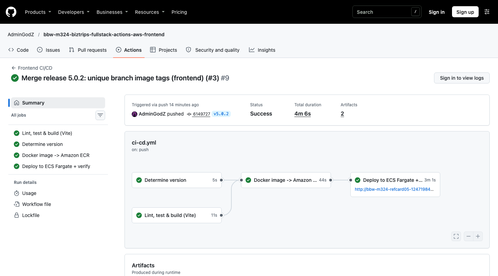
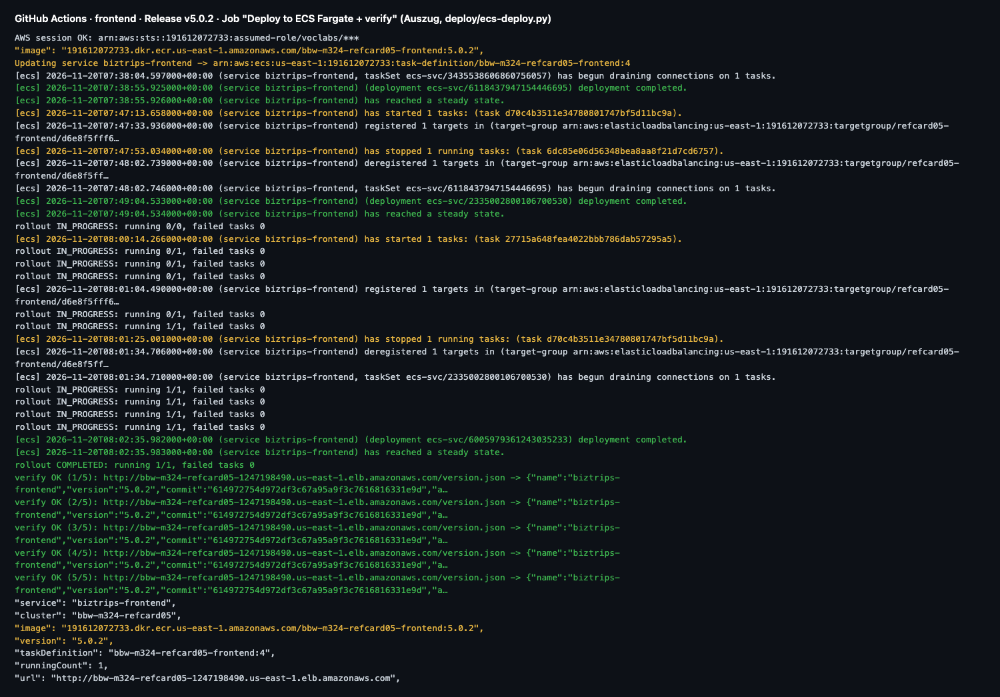
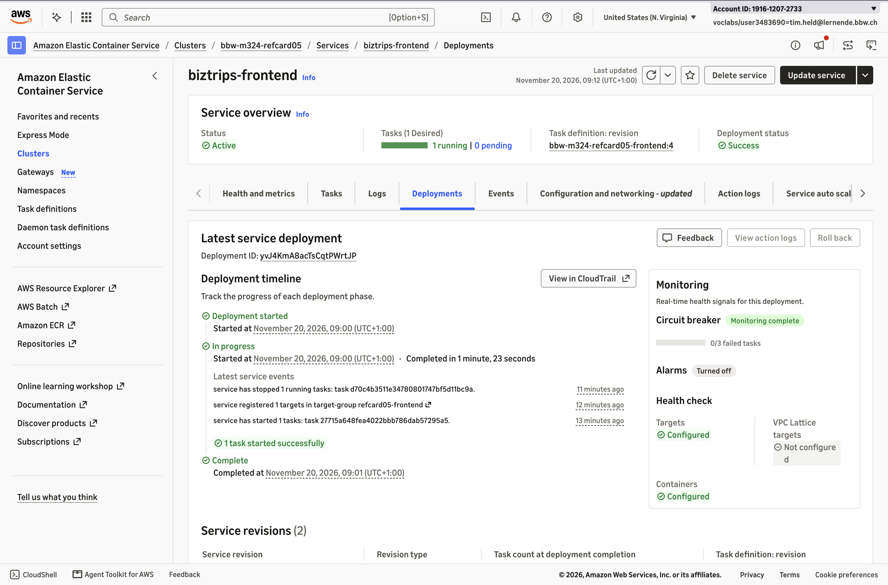
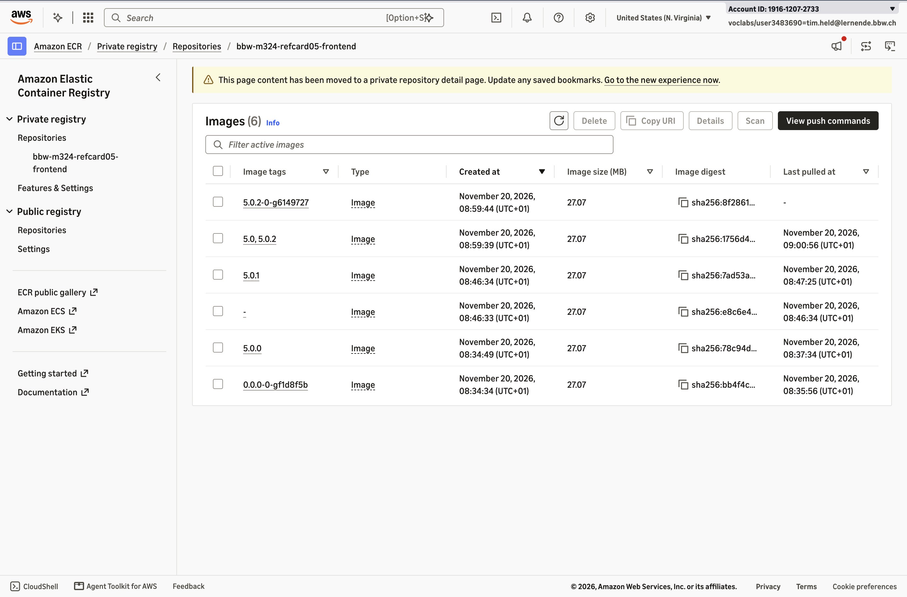
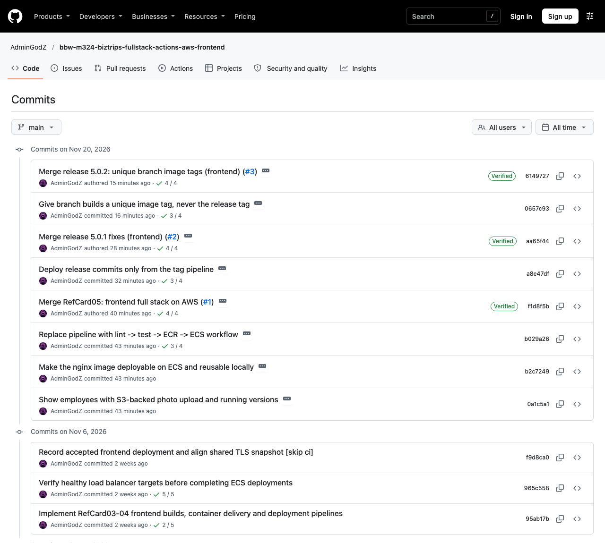
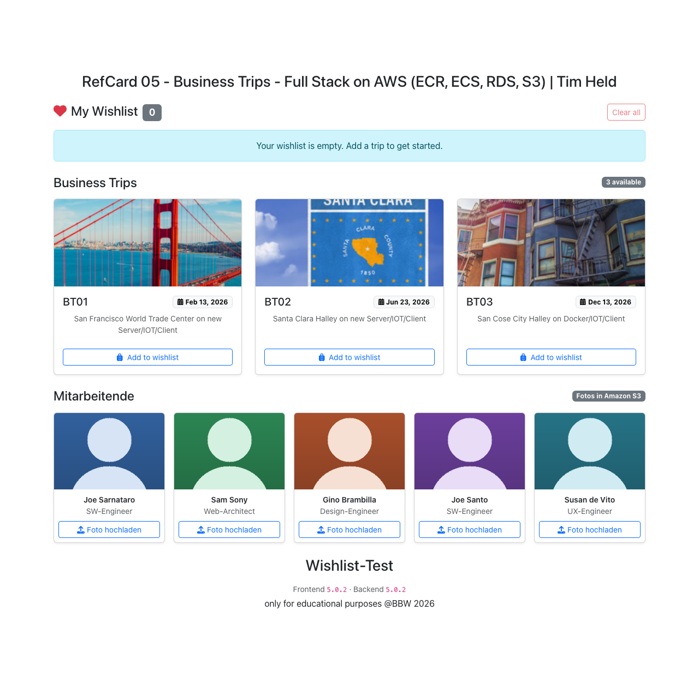

# RefCard05 · Frontend · nginx-Container auf ECS

**Autor:** Tim Held · **Modul:** M324 · **Datum:** 20.11.2026 · **Release:** `v5.0.2`

| Repository | Inhalt |
|---|---|
| **Frontend (dieses Repo)** | React + Vite, nginx-Image, Pipeline |
| [Backend](https://github.com/AdminGodZ/bbw-m324-biztrips-fullstack-actions-aws-backend) | Spring Boot, RDS, S3, Infrastruktur. Ausführliche Doku zu Architektur, IAM, Secrets und OIDC: [docs/REFCARD05.md](https://github.com/AdminGodZ/bbw-m324-biztrips-fullstack-actions-aws-backend/blob/main/docs/REFCARD05.md) |
| [Compose](https://github.com/AdminGodZ/bbw-m324-biztrips-fullstack-compose) | Lokale Entwicklung und Gesamtübersicht |

Live: <http://bbw-m324-refcard05-1247198490.us-east-1.elb.amazonaws.com> (solange die Learner-Lab-Session läuft).

## Was ist neu in RefCard05?

- Abschnitt **Mitarbeitende**: Liste aus `/v1/employees`, Fotos werden über das Backend in **Amazon S3** gespeichert und angezeigt, Upload direkt pro Person. Meldet das Backend `503` (z. B. fehlende S3-Rechte), erscheint dessen Meldung beim Upload.
- **Versionsanzeige** im Footer: `Frontend 5.0.2 · Backend 5.0.2` (Build-Version und `/actuator/info` des Backends).
- Header: „RefCard 05 … | Tim Held“.

## 1 · Pipeline: lint → test → build → Image → ECR → ECS

Datei: [`.github/workflows/ci-cd.yml`](../.github/workflows/ci-cd.yml), gleich aufgebaut wie im Backend.

| Job | Aufgabe | Robustheit |
|---|---|---|
| `Lint, test & build (Vite)` | ESLint mit `--max-warnings=0`, 10 Vitest-Tests (Upload, Fehlerfall 503, Versionsanzeige, API-URLs, Wishlist), Produktions-Build | npm-Cache, JUnit-Report als Tabelle in der Job-Summary und als Artefakt |
| `Determine version` | SemVer aus dem Git-Tag, z. B. `v5.0.2` → `5.0.2` | prüft das Tag-Format |
| `Docker image -> Amazon ECR` | Multi-Stage: `node:24-alpine` (Vite-Build) → `nginx:stable-alpine`. Push nach `bbw-m324-refcard05-frontend` mit den Tags `5.0.2`, `5.0` | BuildKit-Cache `type=gha`, npm-Cache-Mount, auf PRs ohne Push |
| `Deploy to ECS Fargate + verify` | neue Task-Definition → Service-Update → Rollout abwarten → `/version.json` über den ALB muss 5× hintereinander die neue Version liefern | Circuit Breaker mit Rollback, `concurrency: ecs-frontend`, Release-Schutz |

Die Learner-Lab-Zugangsdaten liegen als drei GitHub Secrets vor (`AWS_ACCESS_KEY_ID`, `AWS_SECRET_ACCESS_KEY`, `AWS_SESSION_TOKEN`) und werden von [`.github/actions/aws-learner-lab`](../.github/actions/aws-learner-lab/action.yml) geprüft. Der Ablauf zum Erneuern und der Vergleich mit OIDC stehen in der [Backend-Doku, Abschnitt 7](https://github.com/AdminGodZ/bbw-m324-biztrips-fullstack-actions-aws-backend/blob/main/docs/REFCARD05.md#7--learner-lab-zugangsdaten-als-github-secrets).

Deploy-Log mit Rolling Update und Verifikation: [deploy-log-v5.0.2.txt](evidence/refcard05/deploy-log-v5.0.2.txt)

## 2 · `VITE_API_BASE_URL` = URL des Backend-Service

| Ort | Wert |
|---|---|
| GitHub **Variable** `VITE_API_BASE_URL` | `http://bbw-m324-refcard05-1247198490.us-east-1.elb.amazonaws.com`, die URL, unter der der Backend-Service erreichbar ist. Der ALB leitet `/v1/*` und `/actuator/*` an den Service `biztrips-backend` weiter. |
| Build | Wird als Build-Arg in das Image eingebrannt und im Test-Job für den Vite-Build verwendet |
| Prüfen | `curl <url>/version.json` → `"apiBaseUrl": "http://bbw-m324-refcard05-…elb.amazonaws.com"` |

Weil der Wert in den Build eingebrannt ist, würde dasselbe Image lokal das AWS-Backend aufrufen. Deshalb gibt es eine optionale **Laufzeit-Übersteuerung**: Ist die Container-Variable `API_BASE_URL` gesetzt (Compose: `/`), schreibt [`docker/40-runtime-config.sh`](../docker/40-runtime-config.sh) beim Start `/config.js`. Ungültige Werte führen zu einem Abbruch beim Start. Auf ECS bleibt die Variable leer, dort gilt der Build-Wert.

## 3 · nginx-Container auf ECS Fargate

| Einstellung | Wert |
|---|---|
| Task-Grösse | 0.25 vCPU / 512 MB |
| Health-Check Container und ALB | `GET /health` → `ok` (Container: `wget` alle 15 s, ALB: 2× healthy / 3× unhealthy) |
| Deployment | Rolling 100 % / 200 %, Circuit Breaker mit Rollback, Grace-Periode 180 s, Deregistrierung 15 s |
| nginx | `server_tokens off`, gzip, `X-Content-Type-Options`, `X-Frame-Options`, `Referrer-Policy`. `index.html`, `version.json` und `config.js` ohne Cache, `/assets/` 1 Jahr (Dateinamen mit Hash). Das Backend wird pro Request aufgelöst, nginx startet also auch, wenn das Backend gerade nicht erreichbar ist. |
| Logs | CloudWatch `/ecs/bbw-m324-refcard05`, Stream-Präfix `frontend` |

## 4 · Versionierung

Gleiches Schema wie im Backend: Tag `vX.Y.Z` → ECR-Tags `X.Y.Z` und `X.Y`. Builds von `main` heissen `git describe --long`, z. B. `5.0.2-2-gabc1234`, und überschreiben deshalb nie einen Release-Tag. Die Version steht in `/version.json` (mit Commit), im Footer, im OCI-Label und als Tag `Version` an der Task-Definition.

| Release | Inhalt |
|---|---|
| `v5.0.0` | Mitarbeitende mit S3-Fotos, Versionsanzeige, ECS-taugliches nginx-Image, neue Pipeline |
| `v5.0.1` | Release-Schutz in der Pipeline (gemeinsam mit Backend `v5.0.1`) |
| `v5.0.2` | eindeutige Image-Tags für Branch-Builds |

## 5 · Lokal

- Komplettes System: [Compose-Repo](https://github.com/AdminGodZ/bbw-m324-biztrips-fullstack-compose)
- Nur Frontend: `npm ci && npm run dev`. Vite leitet `/v1` an `localhost:8080` weiter.
- Checks: `npm run lint`, `npm test`, `npm run build`

## 6 · Nachweise

| | |
|---|---|
| Commits |  |
| Workflow |  |
| ECR |  |
| ECS |  |
| Anwendung |  |
